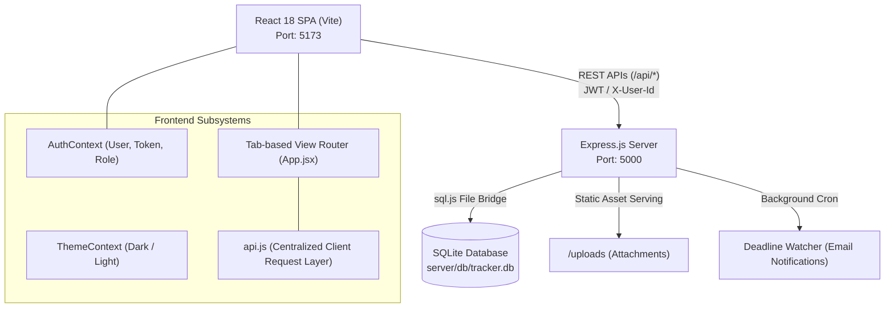
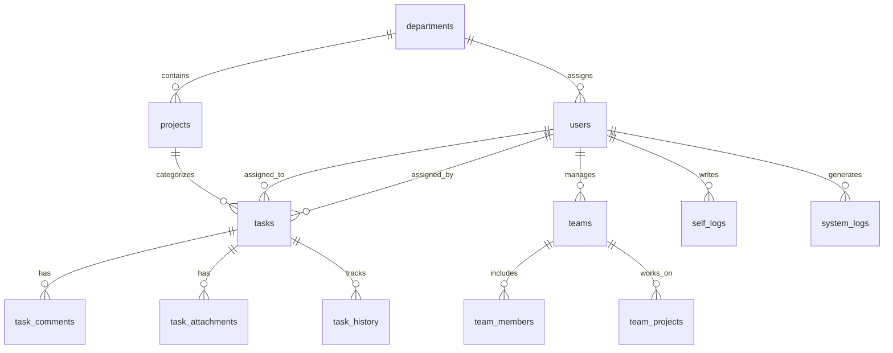

# 🗺️ Call Astro Task Tracker — Comprehensive Project Map & Architecture Guide

> **Purpose:** This document serves as the master structural map and technical reference for the Task Tracker application. It is designed to give developers and AI coding agents instant architectural context, eliminating redundant exploration and drastically reducing analysis time for any future enhancement, debugging, or maintenance task.

---

## 📑 Table of Contents
1. [Executive Overview & Tech Stack](#1-executive-overview--tech-stack)
2. [High-Level System Architecture](#2-high-level-system-architecture)
3. [Master Repository Directory Tree](#3-master-repository-directory-tree)
4. [Role & Permission Matrix](#4-role--permission-matrix)
5. [Database Schema & Entity Relationship Map](#5-database-schema--entity-relationship-map)
6. [Backend API Reference & Endpoints](#6-backend-api-reference--endpoints)
7. [Frontend Architecture & Routing Map](#7-frontend-architecture--routing-map)
8. [Modals & Component Catalog](#8-modals--component-catalog)
9. [Key Business Logics & Gotchas](#9-key-business-logics--gotchas)
10. [Development & Verification Cheat Sheet](#10-development--verification-cheat-sheet)

---

## 1. Executive Overview & Tech Stack

| Domain | Technology / Library | Description |
| :--- | :--- | :--- |
| **Frontend Framework** | **React 18 + Vite** | Single Page Application (SPA), ultra-fast HMR and bundling |
| **Styling & Theme** | **Tailwind CSS + Custom CSS** | Dark-first glassmorphism design system with ambient brand watermarks |
| **Icons** | **Lucide React** | Consistent iconography across all navigation, modals, and status badges |
| **Backend Runtime** | **Node.js (ESM) + Express.js** | RESTful HTTP API server with JSON middleware and static file serving |
| **Database Engine** | **SQLite via `sql.js`** | File-backed in-memory SQLite database (`server/db/tracker.db`) |
| **Authentication** | **JWT + Bearer Token + `X-User-Id`** | Role-authenticated endpoints, bcrypt hashed passwords |
| **File Storage** | **Multer + `/uploads`** | Task attachments and media saved locally with 10MB limits |
| **Email Notification Engine** | **Nodemailer (Enterprise SMTP via `mail.call-astro.in`)** | Multi-channel automated notifications: task generation, field modifications, 24h deadline warnings, overdue alerts, user lifecycle (welcome, role update, offboarding), and squad project allocations |


---

## 2. High-Level System Architecture



---

## 3. Master Repository Directory Tree

```text
Task_Tracker/
├── PROJECT_MAP.md                 # 🗺️ Master Project Map & Architecture Guide (This file)
├── package.json                   # Dependencies, build scripts & concurrency commands
├── vite.config.js                 # Vite build & dev-server proxy configuration
├── tailwind.config.js             # Theme tokens, font families, custom animations
├── index.html                     # HTML root entry with font preloads
│
├── server/                        # 🖥️ BACKEND SYSTEM
│   ├── index.js                   # Server entry point, middleware & route mounting
│   ├── db/
│   │   ├── index.js               # Database connection, schemas, and live schema migrations
│   │   └── tracker.db             # Binary SQLite database file
│   ├── middleware/                # Auth & rate-limiting middleware
│   ├── routes/
│   │   ├── auth.js                # Auth, registration, password reset, and user admin CRUD
│   │   ├── tasks.js               # Task lifecycle: CRUD, attachments, comments, time tracking, recycle bin
│   │   ├── metadata.js            # Departments, projects, analytics KPIs & summary statistics
│   │   ├── teams.js               # Team squads, manager associations, member assignments
│   │   ├── selfLogs.js            # Personal tasks, quick notes, and calendar deliverables
│   │   └── auditLogs.js           # Immutable system action logs & change history
│   └── utils/
│       ├── emailHelper.js         # Automated notification engine (tasks, users, project allocations & deadline daemon)
│       ├── taskLoopHelper.js      # Repeat task cycle daemon & reset automation
│       └── attachmentHelper.js    # Multer disk storage & permanent purge cleanup

│
├── src/                           # 💻 FRONTEND SYSTEM
│   ├── main.jsx                   # React root hydration with Context Providers
│   ├── App.jsx                    # Root application component & primary tab router
│   ├── index.css                  # Global design system, glassmorphic tokens, scrollbar styling
│   │
│   ├── context/
│   │   ├── AuthContext.jsx        # Login, logout, user profile state, token retention
│   │   └── ThemeContext.jsx       # Theme toggle state (dark / light mode)
│   │
│   ├── services/
│   │   └── api.js                 # Unified frontend API client (all fetch requests routed here)
│   │
│   ├── constants/
│   │   └── tasks.js               # Enums: Task priorities, statuses, and admin role options
│   │
│   ├── hooks/
│   │   ├── useTasks.js            # Task fetching, filtering & state management hook
│   │   └── useMetadata.js         # Departments, projects, and employees lookup hook
│   │
│   ├── components/                # 🧩 REUSABLE UI MODULES
│   │   ├── index.js               # Central export barrel for all components & modals
│   │   ├── layout/
│   │   │   ├── Navbar.jsx         # Sticky top banner with brand, home, refresh, and profile
│   │   │   └── TopNav.jsx         # Horizontal navigation tab bar (role-permission filtered)
│   │   ├── tasks/
│   │   │   ├── FilterBar.jsx      # Multi-dimensional search, status, priority, and date filters
│   │   │   ├── SummaryCards.jsx   # Top metric KPI cards (Total, In Progress, Completed, Overdue)
│   │   │   └── TaskTable.jsx      # High-density task data table with inline quick actions
│   │   ├── ui/
│   │   │   ├── PriorityBadge.jsx  # Color-coded pill badge (Low, Medium, High, Critical)
│   │   │   └── StatusBadge.jsx    # Status indicators (Not Started, In Progress, On Hold, Completed, Overdue)
│   │   └── modals/
│   │       ├── CreateTaskModal.jsx        # Comprehensive task creation modal (rich inputs & dates)
│   │       ├── EditTaskModal.jsx          # Edit existing task properties & assignment
│   │       ├── TaskDetailsModal.jsx       # Deep-dive modal: history, hours, attachments, comments
│   │       ├── AddEmployeeModal.jsx       # Employee onboarding modal (with Make Manager button)
│   │       ├── EditUserModal.jsx          # Modify user name, email, role, title, and department
│   │       ├── EmployeeAnalyticsModal.jsx # Individual staff KPI scorecard & task breakdown
│   │       ├── ResetPasswordModal.jsx     # Admin-assisted password reset dialog
│   │       ├── AddDepartmentModal.jsx     # Create company department
│   │       ├── AddProjectModal.jsx        # Create project under department (name, dept, desc, links, media, remarks)
│   │       ├── EditProjectModal.jsx       # Update project details (name, dept, desc, links, media, remarks)
│   │       ├── ViewProjectModal.jsx       # Project viewer modal (title, dept, tasks, links, media preview, remarks)
│   │       ├── CreateTeamModal.jsx        # Squad & project formation modal with lead & draft members
│   │       ├── EditTeamModal.jsx          # Edit squad, description, lead, project & roster
│   │       ├── ViewTeamModal.jsx          # Squad inspector with team members list & project details trigger
│   │       ├── ProjectDetailsModal.jsx    # Project deliverables scorecard modal
│   │       └── AddTeamMemberModal.jsx     # Add staff/interns with roles to squads
│   │   └── teams/
│   │       └── TeamCard.jsx               # High-contrast squad card with IDs, lead, members & action buttons
│   │
│   └── pages/                     # 📄 APPLICATION VIEWS
│       ├── Login.jsx              # Beautiful split-screen credential authentication
│       ├── AdminView.jsx          # High-level executive cockpit (company deliverables & metrics)
│       ├── AdminSettingsView.jsx  # Account provisioning, user credential registry, manager promotion
│       ├── EmployeeDashboard.jsx  # Personal workspace for staff (assigned to me, by me, completed)
│       ├── ManagerView.jsx        # Team formation, squad leadership, member assignment, team card inspection & editing
│       ├── DirectoryView.jsx      # Directories for Employees, Projects, and Departments
│       ├── SelfLogsView.jsx       # Personal workspace: Personal Tasks, Quick Notes, Interactive Calendar
│       ├── AuditLogsView.jsx      # Immutable audit trail of system activities
│       ├── CalendarView.jsx       # Monthly calendar schedule of tasks & deadlines
│       ├── RecycleBinView.jsx     # Soft-deleted task restoration and permanent purging
│       └── ReportsView.jsx        # Analytical summaries and deliverable reports
│
└── uploads/                       # 📁 File attachments stored on disk
```

---

## 4. Role & Permission Matrix

The application supports 4 distinct user roles:

| Capability / Section | Admin 👑 | Manager 🛡️ | Employee 👤 | Intern 🎓 |
| :--- | :---: | :---: | :---: | :---: |
| **Company Executive Dashboard** (`AdminView`) | ✅ | ❌ | ❌ | ❌ |
| **Admin & Security Console** (`AdminSettingsView`) | ✅ | ❌ | ❌ | ❌ |
| **Directory Management** (Employees, Projects, Depts) | ✅ | ❌ | ❌ | ❌ |
| **Promote Employee to Manager** | ✅ | ❌ | ❌ | ❌ |
| **Recycle Bin & Task Restoration** | ✅ | ❌ | ❌ | ❌ |
| **System Audit Logs** | ✅ | ❌ | ❌ | ❌ |
| **Teams & Squad Management** (`ManagerView`) | ✅ | ✅ | ❌ | ❌ |
| **Task Delegation & Assignment** | ✅ | ✅ | ✅ | ✅ |
| **Personal Dashboard & Deliverables** | ✅ | ✅ | ✅ | ✅ |
| **Personal Self-Logs, Notes & Calendar** | ✅ | ✅ | ✅ | ✅ |
| **Can Be Promoted to Manager?** | N/A | Current | **YES** | ❌ *(Blocked)* |

> ⚠️ **Key Rule:** Only standard `Employee` accounts can be promoted to `Manager`. Accounts with the `Intern` role are strictly prohibited from holding the Manager role or designation title on both frontend and backend.

---

## 5. Database Schema & Entity Relationship Map



### Table Specifications:
1. **`users`**: `id`, `name`, `email`, `password`, `role` (Admin/Manager/Employee/Intern), `department_id`, `title`, `created_at`
2. **`departments`**: `id`, `name`, `description`
3. **`projects`**: `id`, `name`, `department_id`, `description`
4. **`tasks`**:
   - `id`, `task_id` (e.g. `TSK-1001`), `title`, `description`
   - `assigned_by`, `assigned_to` *(nullable to preserve tasks when staff are deleted)*
   - `project_id`, `department_id`, `team_id`
   - `assigned_date`, `start_date`, `due_date` *(nullable)*, `completed_date`
   - `priority` (Low, Medium, High, Critical)
   - `status` (Not Started, In Progress, On Hold, Completed, Overdue)
   - `estimated_hours`, `actual_hours`, `started_at`, `completed_at`, `completion_duration_hours`
   - `deleted_at` *(soft delete flag for Recycle Bin)*
5. **`task_comments`**: `id`, `task_id`, `user_id`, `comment`, `created_at`
6. **`task_attachments`**: `id`, `task_id`, `user_id`, `file_name`, `file_path`, `file_size`, `uploaded_at`
7. **`task_history`**: `id`, `task_id`, `user_id`, `user_name`, `action`, `old_value`, `new_value`, `created_at`
8. **`teams`**, **`team_members`**, **`team_projects`**: Squad and lead grouping
9. **`self_logs`**: `id`, `user_id`, `log_id`, `title`, `type` (task/note), `description`, `content`, `links`, `start_date`, `due_date`, `completed_date`, `status`, `category`
10. **`system_logs`**: `id`, `user_id`, `user_name`, `role`, `action`, `entity_type`, `entity_id`, `details`, `created_at`

---

## 6. Backend API Reference & Endpoints

All endpoints are prefixed with `/api` and defined across `server/routes/`:

### Authentication & Users (`server/routes/auth.js`)
- `POST /api/auth/login` — Authenticate credentials & return token + user profile
- `GET /api/auth/me` — Validate session token and retrieve current user
- `GET /api/auth/users` — List active user accounts
- `POST /api/auth/admin/users` — Provision new login account (supports Employee, Manager, Intern, Admin)
- `PUT /api/auth/admin/users/:id` — Update profile, role (Manager/Employee/Intern/Admin), or department
- `PUT /api/auth/admin/users/:id/password` — Admin force password reset
- `DELETE /api/auth/admin/users/:id` — Remove user account (preserves tasks)

### Tasks Lifecycle (`server/routes/tasks.js`)
- `GET /api/tasks` — List tasks with filters (status, priority, department, project, search, scope)
- `POST /api/tasks` — Create new deliverable task (auto-generates task ID e.g. `TSK-1042`)
- `GET /api/tasks/:id` — Get full task record with history, comments & attachments
- `PUT /api/tasks/:id` — Update task details, status, priority, hours, or assignment
- `DELETE /api/tasks/:id` — Soft-delete task (moves to Recycle Bin)
- `POST /api/tasks/:id/restore` — Restore task from Recycle Bin
- `DELETE /api/tasks/:id/permanent` — Permanently purge task record from database
- `POST /api/tasks/:id/comments` — Add threaded task comment
- `POST /api/tasks/:id/attachments` — Upload file attachment via multer
- `DELETE /api/tasks/:id/attachments/:attId` — Delete task attachment

### Metadata & Operations (`server/routes/metadata.js`)
- `GET /api/departments` & `POST /api/departments` & `DELETE /api/departments/:id`
- `GET /api/projects` & `POST /api/projects` & `PUT /api/projects/:id` & `DELETE /api/projects/:id`
- `GET /api/employees` — Formatted employee performance list
- `GET /api/employees/:id/analytics` — Deep scorecard: completion rate, priority breakdown, overdues
- `GET /api/admin/stats` — High-level KPI aggregations for executive dashboard

### Teams, Self Logs & Audits
- `/api/teams/*` (`server/routes/teams.js`) — Squad creation (auto hidden team ID, team or project name, draft members with optional roles), member linking, full project editing via `PUT /:id` (project name, department, description, linking), deliverable KPI metrics in `GET /:id`, and automated email dispatches via `POST /:id/projects`, `POST /`, `PUT /:id`, and `POST /:id/members` on project allocations.
- `/api/self-logs/*` (`server/routes/selfLogs.js`) — Personal deliverable logs, notes & quick calendar entries
- `/api/audit-logs/*` (`server/routes/auditLogs.js`) — Read-only immutable system event history (Admin only)


---

## 7. Frontend Architecture & Routing Map

The frontend does not use standard path routing; it uses a **stateful tab-based router** inside `src/App.jsx` based on `currentTab`:

```
App.jsx (currentTab)
 ├── 'dashboard'          ──> AdminView (if Admin) | EmployeeDashboard (if Staff/Manager)
 │                           └── FilterBar with Assignment Scope (All Tasks / Assigned to Me / Assigned to Others)
 ├── 'admin_settings'     ──> AdminSettingsView (Admin only)
 ├── 'completed_tasks'    ──> EmployeeDashboard (filterCompletedOnly: true)
 ├── 'teams'              ──> ManagerView (Admin & Manager)
 ├── 'self_logs'          ──> SelfLogsView (Personal tasks, Quick notes, Calendar view)
 ├── 'audit_logs'         ──> AuditLogsView (Admin only)
 ├── 'employees'          ──> DirectoryView (type: 'employees')
 ├── 'projects'           ──> DirectoryView (type: 'projects')
│   ├── 'departments'        ──> DirectoryView (type: 'departments')
│   ├── 'reports'            ──> ReportsView (Manager Workload by Project & Overall Employee Reports)
│   └── 'recycle_bin'        ──> RecycleBinView (Admin only)
```

---

## 8. Modals & Component Catalog

All modals are exported via `src/components/index.js` and render via React Portals (`createPortal`):

1. **`CreateTaskModal.jsx`**: Global quick-task creator triggered from top navigation. Supports estimated hours, nullable due dates, department & project selectors.
2. **`EditTaskModal.jsx`**: Pre-populates all task fields for editing.
3. **`TaskDetailsModal.jsx`**: Complete task inspection window. Includes real-time timer/hours logger, attachment uploader, comment thread, and chronological audit history.
4. **`AddEmployeeModal.jsx`**: Fast user creation modal. Features a **"Make this employee a Manager"** toggle button.
5. **`EditUserModal.jsx`**: Edit user full name, email, department, role, and job title.
6. **`EmployeeAnalyticsModal.jsx`**: High-impact performance scorecard with time-based presets (All Time, Today, 7D, 30D, This Month, 90D, This Year, Custom Range), dynamic KPI recalculation, priority/status breakdown charts, and one-click CSV report export.
7. **`ResetPasswordModal.jsx`**: Simple dialog for setting a new password on any user account.
8. **`AddProjectModal.jsx` / `EditProjectModal.jsx`**: Project CRUD dialogs.
9. **`AddDepartmentModal.jsx`**: Department creation dialog.
10. **`CreateTeamModal.jsx`**: Isolated, self-contained squad & project creation modal with lead and initial draft member assignments.
11. **`EditTeamModal.jsx`**: Modify team title, lead, description, allocated project, and inline member roster (add/remove).
12. **`ViewTeamModal.jsx`**: Inspect team overview, lead, allocated project, description, member list, and trigger the project details modal.
13. **`ProjectDetailsModal.jsx`**: Detailed scorecard of project deliverables, health metrics, and department info.
14. **`AddTeamMemberModal.jsx`**: Dialog to add employee/intern members to existing squads.
15. **`TeamCard.jsx`**: Reusable squad card with vibrant dark-mode badges for Team ID and Project ID.

---

## 9. Key Business Logics & Gotchas

1. **Manager View Personalization & Role Isolation**:
   - `ManagerView` is personalized per manager. When a user with `role === 'Manager'` views the page, the backend scopes squads to those they lead (`t.manager_id`), created (`t.created_by`), belong to (`team_members`), or allocated projects to (`team_projects.assigned_by`).
   - `GET /employees` returns all staff (`u.role IN ('Employee', 'Intern', 'Manager')`) so managers remain visible in employee directories, analytics, and squad rosters.
   - Administrators (`role === 'Admin'`) have an overview of all squads across the organization, plus a dedicated Manager Filter to inspect any specific manager's squad ecosystem.
2. **Nullable Due Date Support**: Tasks do not require a due date. Both backend and frontend allow `due_date = null` without crashing.
3. **Task Preservation on User Deletion**: When an employee or manager is deleted from the system, their assigned tasks are **not deleted**. `assigned_to` and `assigned_by` become nullable or unlinked, allowing tasks to be reassigned to other team members.
4. **Manager Role & Designation**:
   - `role === 'Manager'` has special privileges (access to Teams view, badge styling).
   - Only `Employee` accounts can be promoted to `Manager`.
   - `Intern` accounts **cannot** be promoted to `Manager` (enforced in `DirectoryView`, `AdminSettingsView`, and `server/routes/auth.js`).
5. **Interactive Calendar in Self Logs**:
   - Features color-coded date cells (Sunday highlighted in dark/light red, active task indicators).
   - Legend items: *Not Started*, *In Progress*, *Completed*, *On Hold*.
6. **Quick Notes & Clipboard**:
   - Long text inside quick notes has line-clamp and word-wrap to prevent overflowing the card boundary.
   - Includes a quick **Copy Description** button (<kbd>📋</kbd>) with feedback animation and a **View Modal** (<kbd>👁️</kbd>).
7. **Automated Enterprise Email Notification Engine (`server/utils/emailHelper.js`)**:
   - **Custom Corporate SMTP Integration:** Connected to `mail.call-astro.in` on port 465 (SSL) with TLS bypass (`rejectUnauthorized: false`) for self-hosted or custom certificate domains.
   - **Task Lifecycle Alerts:**
     - `sendTaskAssignedEmail`: Instant assignment notice with priority badge, project name, deadline, and manager name.
     - `sendTaskModifiedEmail`: Visual table diff of previous vs. updated fields when task parameters change.
     - `sendDeadlineWarningEmail`: Periodic daemon (every 30 mins) checking tasks due within 24 hours.
     - `sendTaskOverdueEmail`: Immediate red alert when a task misses its scheduled deadline.
     - `sendTaskLoopWarningEmail` & `sendTaskLoopResetEmail`: Automated notifications for recurring cycle reset loops.
   - **User Lifecycle & Onboarding Alerts:**
     - `sendUserWelcomeEmail`: Onboarding email when a new user is created as Admin, Manager, Employee, or Intern with temporary credentials, portal URL, and role badge.
     - `sendUserRoleChangedEmail`: Dispatched when user role is updated or promoted.
     - `sendUserDeactivatedEmail`: Formal offboarding notice when an account is deleted or deactivated.
   - **Project & Squad Allocation Alerts (`sendProjectAllocatedEmail`):**
     - **Team Project Allocation (`POST /api/teams/:id/projects`):** Automatically notifies all members of the squad and the squad manager when a project is linked.
     - **Squad Creation with Project (`POST /api/teams`):** Notifies team lead and draft members upon squad creation with an allocated project.
     - **Squad Project Reassignment (`PUT /api/teams/:id`):** Alerts squad members when the team's project changes.
     - **New Member Addition (`POST /api/teams/:id/members`):** Immediately welcomes and informs new joiners of all projects active in the squad.
     - **Department Project Assignment (`POST /api/projects`):** Notifies department managers/leads of newly allocated projects.
8. **WhatsApp-Style Task Chatbox & Media Preview:**
   - Threaded comment area supporting formatted text and direct clipboard image pasting (<kbd>Ctrl</kbd> + <kbd>V</kbd>).
   - In-app lightbox viewer allows inspecting full-resolution screenshots directly in the browser without forced downloads, with a dedicated download action button.


---

## 10. Development & Verification Cheat Sheet

- **Start Dev Server (Frontend + Backend concurrently):**
  ```powershell
  npm run dev
  ```
  *Runs Express on port `5000` and Vite on port `5173` with proxy.*
- **Production Build Validation:**
  ```powershell
  npm run build
  ```
- **Database File:**
  - Located at `server/db/tracker.db`.
  - Schema initialization and automatic admin bootstrap are handled by `server/db/index.js`.
- **Primary API Client:**
  - Import `api` from `src/services/api.js`.
  - All calls automatically inject `Authorization: Bearer <token>` and `X-User-Id`.
